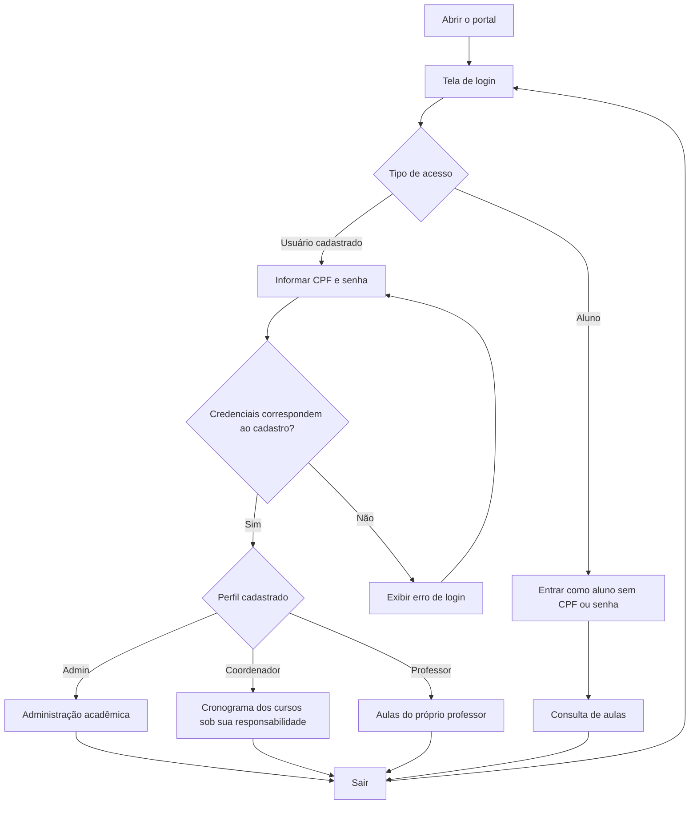
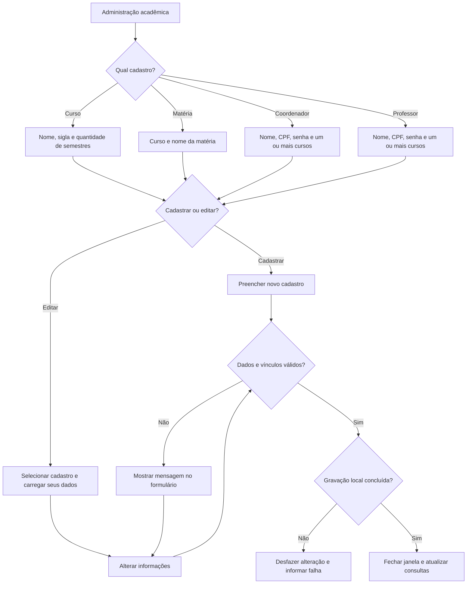
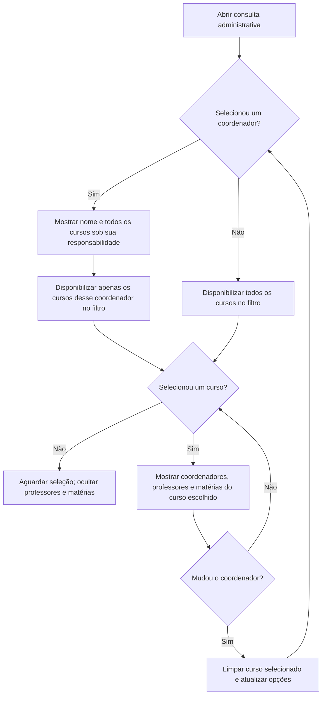
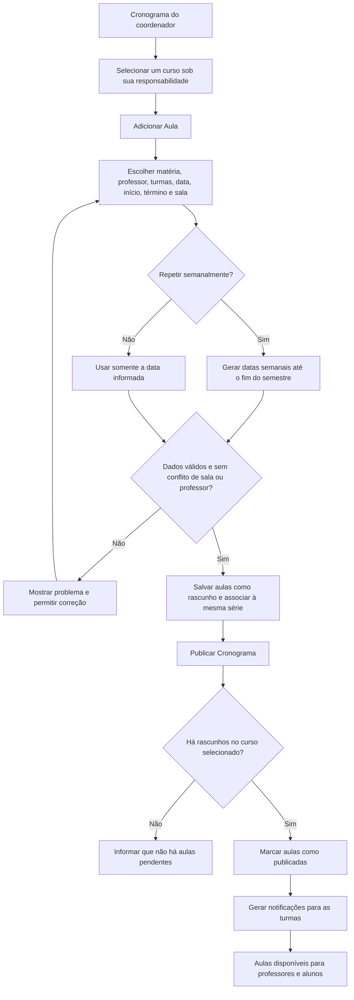
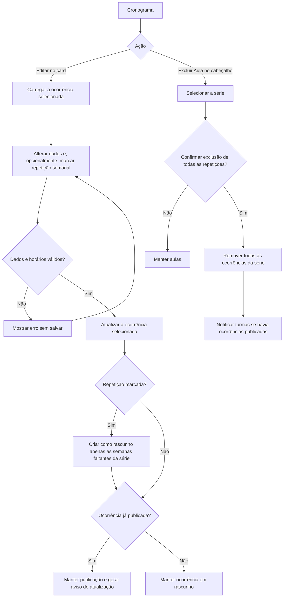
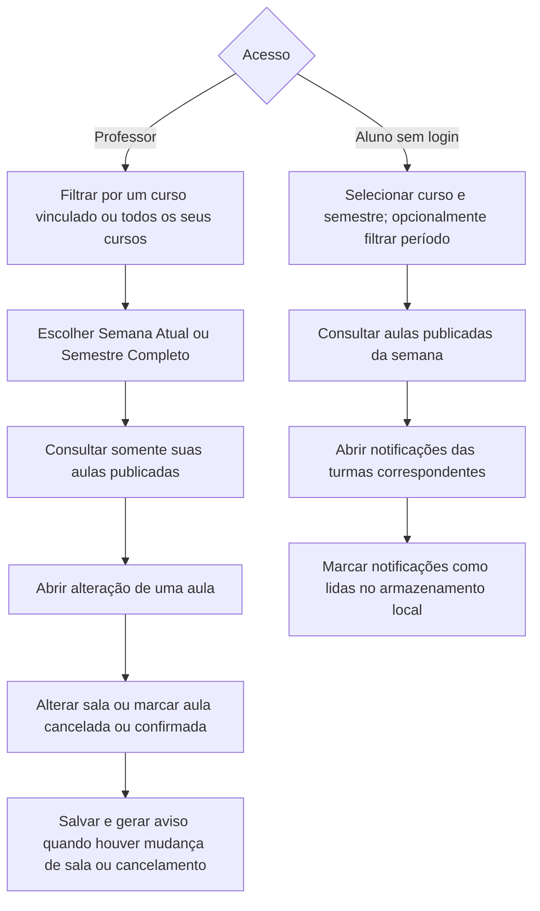
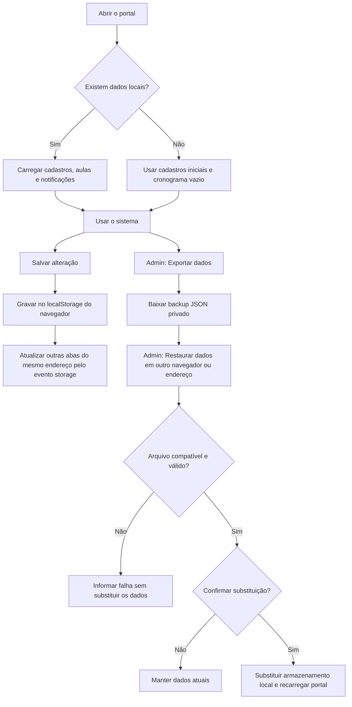

# Projeto Integrado II/III — Sistema Acadêmico

Portal acadêmico de demonstração da **Universidade Anhanguera**, desenvolvido para gerenciar cursos, matérias, coordenadores, professores, horários e salas de aula.

O sistema oferece quatro formas de acesso: **Administrador**, **Coordenador**, **Professor** e **Aluno**. A consulta do aluno não exige cadastro nem dados pessoais.

## Tecnologias

- HTML e JavaScript para as telas e regras da aplicação.
- Tailwind CSS via CDN para a interface responsiva.
- `localStorage` para persistência dos dados no navegador.
- Mermaid para os fluxogramas desta documentação.

## Como executar

1. Clone o repositório:

   ```bash
   git clone https://github.com/frodsantana/projeto-integrado-II-III.git
   cd projeto-integrado-II-III
   ```

2. Abra `index.html` no navegador ou sirva a pasta com um servidor estático, como o Live Server do VS Code.
3. Mantenha o mesmo endereço de acesso para utilizar os dados já salvos. O estilo via CDN depende de conexão com a internet.

Não é necessário instalar dependências nem executar uma etapa de build.

## Contas de demonstração

Senha inicial de todas as contas abaixo: **`123456`**. São identificadores fictícios usados apenas na demonstração.

| Perfil | Usuário inicial | CPF de teste |
|---|---|---|
| Administrador | Admin | `999.999.999-99` |
| Coordenador | Anhanguera | `111.111.111-11` |
| Professor | Nicolas Vogiantzis | `222.222.222-22` |
| Professor | Getulio da Silva Santos | `333.333.333-33` |
| Professora | Francisca de Souza | `444.444.444-44` |
| Professor | Luciano Correa | `555.555.555-55` |
| Aluno | Acesso direto pelo botão **Entrar como aluno** | Não exige CPF |

Nomes e senhas alterados na administração ou restaurados de um backup substituem os valores iniciais naquele navegador.

## Preservar os dados ao mudar de endereço ou computador

1. Entre como Admin no portal que contém os cadastros.
2. Clique em **Exportar dados** e guarde o JSON em local privado.
3. Abra o portal no novo endereço ou computador e entre como Admin.
4. Clique em **Restaurar dados**, escolha o JSON e confirme a substituição dos dados locais.

O backup contém contas, CPFs e senhas da demonstração. **Não publique esse arquivo no GitHub.** Os arquivos `backup-*.json` e a pasta `backups/` estão excluídos pelo `.gitignore`.

Publicar o código não envia os cadastros do navegador ao GitHub. O protótipo não possui banco compartilhado nem autenticação em servidor.

## Fluxogramas e regras de funcionamento

Os diagramas abaixo usam Mermaid e representam o comportamento implementado no protótipo.

## 1. Acesso ao sistema



O login é uma simulação executada no navegador. As restrições de perfil não substituem autenticação e autorização em um servidor.

## 2. Administração: cadastrar e editar

O cabeçalho reúne quatro grupos, cada um com ações de cadastro e edição. Os formulários abrem em uma janela centralizada.



### Regras dos cadastros

| Cadastro | Comportamento |
|---|---|
| Curso | Cria uma turma inicial por semestre. Na edição, mantém a sigla e permite alterar nome e quantidade de semestres. |
| Matéria | Pertence a um curso. Na edição, primeiro seleciona-se o curso, depois a matéria. O novo nome também é aplicado às aulas existentes. |
| Coordenador | Pode ser responsável por vários cursos. Na edição, mantém o CPF; senha vazia preserva a senha atual. |
| Professor | Pode atuar em vários cursos. O novo nome é aplicado às suas aulas e às sugestões de docente das matérias. Na edição, mantém o CPF; senha vazia preserva a senha atual. |

Não é permitido remover semestres com turmas vinculadas a matérias ou aulas. Para retirar um curso do professor, é necessário primeiro reatribuir ou excluir suas aulas naquele curso.

## 3. Administração: consulta por coordenador e curso



## 4. Coordenador: cadastro e publicação de aulas



### Regras do cronograma

- Professores disponíveis no cadastro são os vinculados ao curso selecionado.
- Horários usam `HH:mm`, em 24 horas; datas exibidas usam `DD/MM/AAAA` e são armazenadas internamente como `AAAA-MM-DD`.
- O término deve ser posterior ao início e estar no mesmo período: matutino, de 08:00 a 11:50, ou noturno, de 19:00 a 22:50.
- O semestre configurado é de **03/08/2026 a 18/12/2026**, com aulas em dias úteis.
- A verificação de conflitos compara intervalos de horário. O código permite compartilhamento para disciplinas com o mesmo nome-base, desconsiderando os sufixos I, II e III.
- Para aulas antigas sem término, a disponibilidade considera ocupação até o fim do período.
- O cronograma abre posicionado na semana atual, limitada ao semestre configurado, mantendo semanas anteriores acessíveis pela rolagem.

## 5. Coordenador: edição e exclusão



Editar uma ocorrência não altera automaticamente as demais ocorrências já existentes. Marcar repetição cria as semanas faltantes. A exclusão, por sua vez, remove toda a série, inclusive ocorrências editadas individualmente que mantêm o mesmo identificador de série.

## 6. Professor e aluno



O filtro de período do aluno filtra as aulas. As notificações são selecionadas pelas turmas do curso e semestre, sem filtro de período. O estado de leitura não é individual por aluno, pois o acesso é anônimo.

## 7. Persistência e backup



### Limites do protótipo

- A chave usada no navegador é `sgh-demo-v3`.
- Não há banco de dados compartilhado nem API de autenticação. As contas, inclusive senhas de demonstração, são armazenadas no cliente.
- GitHub armazena os arquivos do projeto; publicar o código não transfere os dados do navegador nem os sincroniza entre computadores.
- O backup inclui contas, cursos, turmas, matérias, docentes, aulas, notificações e o próximo identificador de aula. Deve ser mantido privado.
- O botão de reset da demonstração limpa aulas e notificações, preservando os cadastros.

## 8. Mapa dos arquivos

| Arquivo | Responsabilidade |
|---|---|
| [`index.html`](index.html) | Telas, filtros, formulários e janelas de cadastro e edição. |
| [`script.js`](script.js) | Login, navegação, cronograma, aulas, notificações e persistência. |
| [`admin.js`](admin.js) | Cadastros administrativos, consulta por curso e coordenador, vínculos de coordenadores. |
| [`admin-edit.js`](admin-edit.js) | Edição de cursos e matérias; cadastro e edição de professores e seus vínculos. |
| [`backup.js`](backup.js) | Exportação, validação e restauração de backups. |

A documentação também está disponível em [Fluxogramas do sistema](docs/FLUXOGRAMAS.md).
