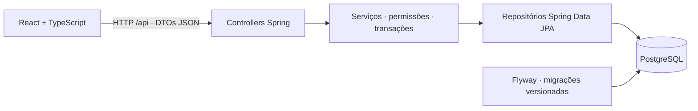

# Arquitetura

O repositório contém uma SPA React e uma API Spring Boot organizada como monólito modular. PostgreSQL é a fonte dos dados. Cada módulo reúne sua funcionalidade; não existem microsserviços ou comunicação entre bancos.

## Frontend

- `app`: rotas por perfil, sessão e estrutura visual.
- `shared`: tipos da API, cliente HTTP, componentes, máscaras e carregamento cancelável.
- `features/auth`: autenticação e acesso anônimo.
- `features/administration`: cadastros e consulta por coordenador/curso.
- `features/schedule`: cronograma, edição de aulas/séries, consultas de professores e alunos e notificações.
- `features/imports`: seleção de backups, remoção de senhas antigas, prévia e confirmação.

React Router controla a navegação. O token fica apenas em memória, em um cliente HTTP compartilhado. Uma resposta 401 encerra a sessão. Requisições obsoletas são descartadas ao mudar filtros ou sessão. React renderiza textos recebidos da API sem inserir HTML arbitrário.

Tailwind é compilado localmente. Botões, campos, mensagens, horários e janelas são compartilhados. O navegador escolhe o dia por um campo nativo de data; datas apresentadas em cards e listas usam DD/MM/AAAA e horários usam 24 horas.

## Backend

Pacotes por funcionalidade: `security`, `users`, `courses`, `subjects`, `groups`, `rooms`, `lessons`, `notifications` e `imports`.

Serviços validam regras, permissões e vínculos; repositórios JPA consultam e persistem entidades. DTOs explícitos preservam os contratos JSON anteriores. IDs, nomes de tabelas e migrações foram mantidos. Não há mais a classe genérica `Database` nem SQL nos controllers.

O Hibernate não cria nem atualiza o esquema automaticamente: `ddl-auto=validate`. O Flyway aplica migrações. `open-in-view=false` evita dependência de sessão JPA durante a serialização HTTP.

A trava PostgreSQL `pg_advisory_xact_lock(20261015)` é adquirida antes de mutações que afetam vínculos e horários. Todas as ocorrências de uma série são validadas e alteradas em uma única transação. Uma falha impede qualquer gravação parcial. A importação mantém as mesmas garantias e usa rollback para a prévia.

## Compatibilidade e execução

O novo frontend usa os endpoints existentes. A API mantém entradas camelCase e os campos históricos snake_case nas respostas. Não houve mudança para JWT, cookies ou login persistente.

O frontend é compilado separadamente. No desenvolvimento, Vite encaminha `/api` ao Spring Boot. Na disponibilização, o servidor HTTP deve encaminhar `/api` à API e servir `index.html` para rotas React.

O modo demonstração foi removido. Dados locais antigos não são apagados nem lidos automaticamente. A importação de backups continua disponível. A migração foi planejada para preservar dados existentes, sem recriar o volume PostgreSQL ou redefinir senhas.
