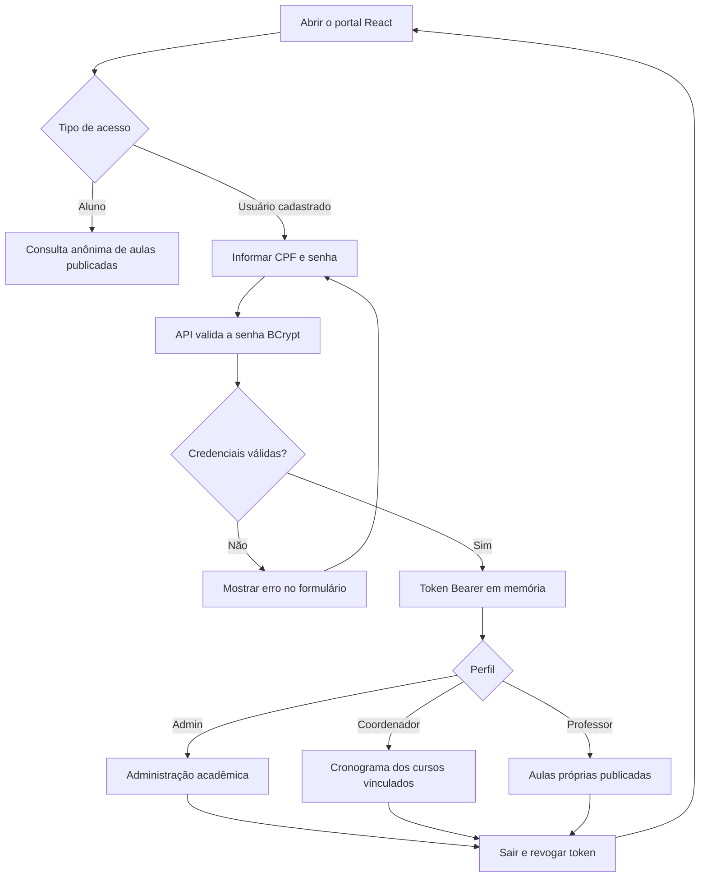
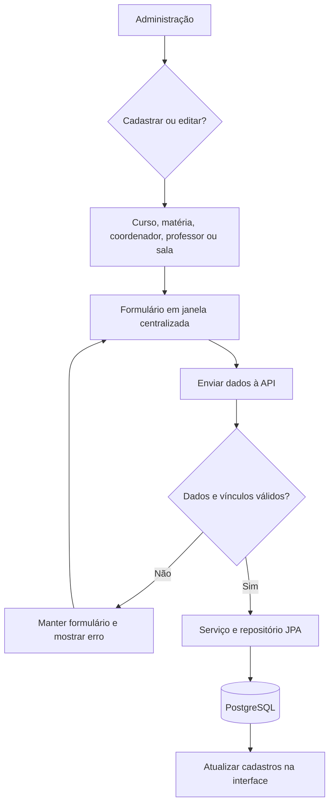
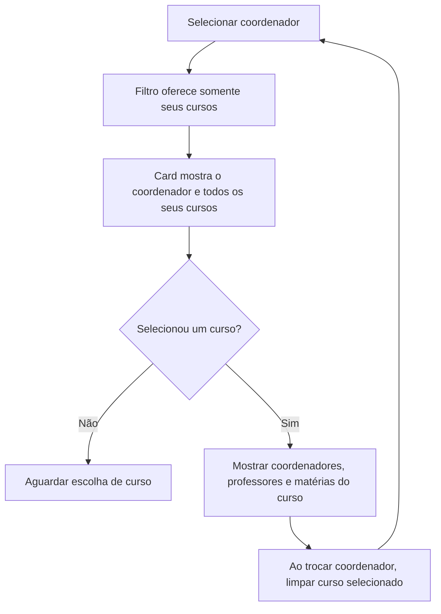
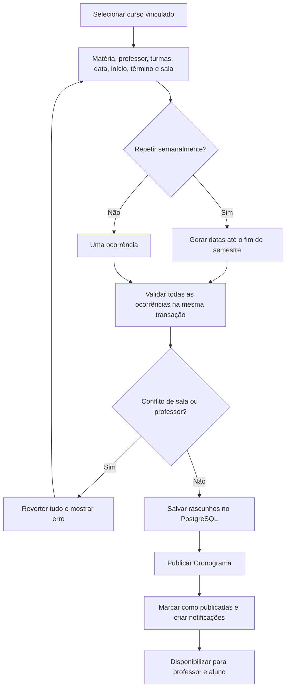
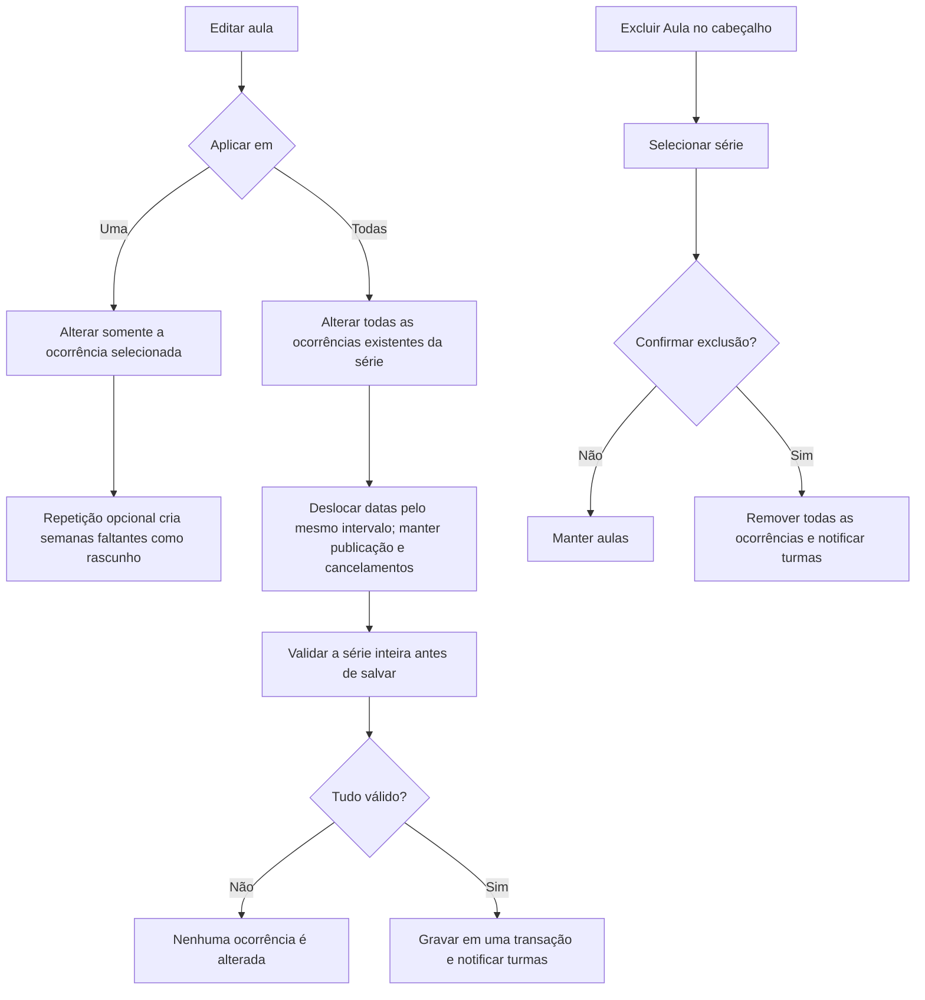
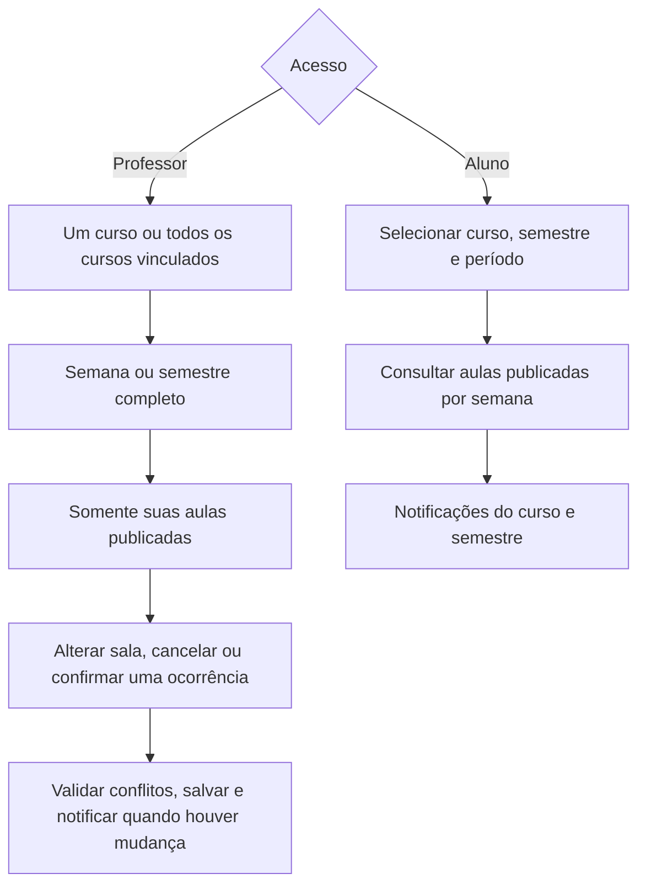
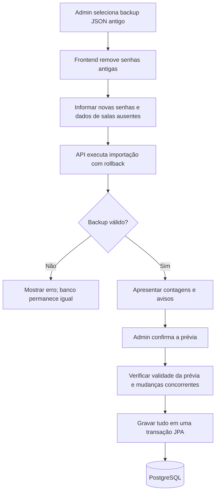

# Fluxogramas do sistema acadêmico

Projeto Integrado II/III — Universidade Anhanguera. Os diagramas representam a versão React + TypeScript com API Spring Boot, Spring Data JPA e PostgreSQL. Não há modo demonstração.

## Acesso

A API valida permissões em cada operação. Tokens duram oito horas; uma resposta 401 encerra a sessão. Recarregar a página exige novo login. Alunos não possuem conta nem identificação individual de leitura.

## Administração

| Cadastro    | Regras                                                                                                                  |
| ----------- | ----------------------------------------------------------------------------------------------------------------------- |
| Curso       | Gera uma turma inicial por semestre. Sigla permanece na edição. Semestres com aulas vinculadas não podem ser removidos. |
| Matéria     | Pertence a um curso. Para editar, selecionar primeiro o curso e depois a matéria.                                       |
| Coordenador | Um ou vários cursos; CPF e perfil permanecem na edição.                                                                 |
| Professor   | Um ou vários cursos; remover vínculo exige reatribuir/excluir aulas daquele curso.                                      |
| Sala        | Nome e andar/tipo. A edição mantém o UUID e os vínculos das aulas.                                          |

Senhas vazias na edição preservam a senha atual. Alterar a senha revoga tokens existentes. Os formulários de coordenador e professor permitem editar todos os vínculos de curso.

## Consulta por coordenador e curso

Sem coordenador selecionado, o filtro disponibiliza todos os cursos. Filtros de pessoas exibem somente o nome, sem CPF.

## Cadastro e publicação de aulas

Horários usam 24 horas, dentro de 08:00–11:50 ou 19:00–22:50. O término precisa ser posterior ao início. O semestre padrão é 03/08/2026–18/12/2026, em dias úteis. Conflitos consideram intervalos sobrepostos e aulas não canceladas, inclusive rascunhos. Matérias com nomes semelhantes não dispensam a validação.

## Edição e exclusão

Editar todas inclui ocorrências passadas e publicadas, sem criar novas repetições. Se uma data ficar fora do semestre ou houver conflito, toda a alteração é rejeitada.

## Professor e aluno

As notificações do aluno são filtradas pelo curso, semestre e semana selecionada, considerando a data da aula. O período matutino/noturno filtra aulas, mas não notificações. A leitura dos avisos fica apenas na sessão anônima. Use Atualizar aulas para buscar mudanças feitas em outro acesso. A visualização inicial é limitada ao semestre configurado; no semestre inteiro, semanas anteriores permanecem acessíveis pela rolagem.

## Importação e persistência

Prévias expiram em dez minutos. Alterar entradas exige nova prévia. A importação é aditiva, reaproveita cadastros compatíveis e mantém senhas existentes. Conflitos impedem a operação inteira. O hash do backup impede repetição da importação.

GitHub armazena código, não os dados do PostgreSQL. A aplicação não usa o antigo localStorage e não o limpa automaticamente. Consulte o [README](../README.md), a [arquitetura](ARQUITETURA.md) e os [testes](TESTES.md).
